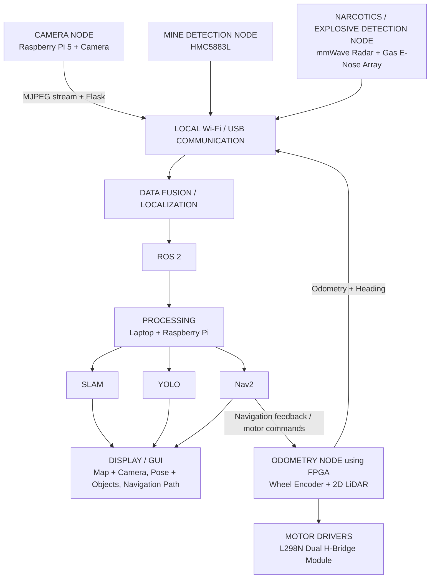

# Mine Nav Rover
### GPS-Denied Autonomous Rover for Perception, Localization, and Navigation

Mine Nav Rover is a modular autonomous ground-rover project designed for GPS-denied environments. Its architecture combines camera-based perception, magnetic-field sensing, a gas-sensor e-nose array, mmWave radar, FPGA-based wheel-encoder odometry, and the **currently integrated 2D LiDAR**. ROS 2 connects the data-fusion/localization, SLAM, YOLO perception, Nav2 navigation, and GUI layers shown in the project architecture.

> **Status note:** This README follows the supplied architecture diagram. Document each feature as operational only after validating it on the rover.

## System architecture



The flowchart represents the system's logical data flow. Confirm actual node names, ROS 2 topics, message formats, and hardware interfaces in the implementation documentation.

## Hardware and sensing nodes

### Camera node — Raspberry Pi 5 + camera
- Captures the rover's visual scene.
- Sends video through an MJPEG stream served by Flask, as shown in the architecture.
- Supplies images to the YOLO perception pipeline.
- `src/opencv_camera.py` is a basic camera test utility; it is not the full Flask streaming or YOLO node.

### Mine-detection node — HMC5883L
- The HMC5883L three-axis magnetometer measures the local magnetic field.
- Can support experiments involving magnetic-field anomalies.
- A magnetometer alone cannot confirm a mine or identify an object. Readings depend on distance, orientation, calibration, and interference from motors, wiring, and nearby metal. This is an experimental sensing node, not certified mine-detection equipment.

### Narcotics / explosive detection node — mmWave radar + gas e-nose array
- Combines data from a mmWave radar and a multi-sensor gas array for experimental sensing.
- The e-nose prototype has used five gas sensors, including MQ-2 and MQ-3. Record the exact models of the remaining sensors in the hardware bill of materials.
- Gas-sensor responses vary with warm-up time, humidity, temperature, airflow, contamination, and sensor age.
- Perfume and hand sanitizer may be used as early bench-test stimuli, but responses to them do not demonstrate narcotics or explosive detection.
- Do not claim reliable identification of narcotics, explosives, or concealed packages without validated hardware, processing, and controlled test results.

### Odometry node — FPGA, wheel encoders + 2D LiDAR
- The FPGA-based odometry node interfaces with wheel encoders and the **2D LiDAR already used on the rover**.
- Wheel encoders provide wheel-rotation measurements for odometry and dead-reckoning estimates.
- 2D LiDAR provides range scans for obstacle perception and can support mapping/SLAM when the driver and ROS 2 integration are configured.
- Odometry and heading are sent through local Wi-Fi/USB communication to the data-fusion/localization layer.
- The diagram shows a control/feedback path between Nav2 and the odometry/motor-control subsystem. Verify the exact interface and firmware against the deployed hardware.

### Motor-driver subsystem
- The architecture identifies an L298N dual H-bridge motor-driver module.
- The controller sends motor commands through the deployed motor-control interface.
- Check motor voltage/current requirements, driver thermal limits, wiring, and controller logic compatibility before operation.

## Software architecture

| Component | Role in the architecture |
|---|---|
| Raspberry Pi 5 | Camera capture/streaming and onboard computing |
| Laptop + Raspberry Pi | Processing and running system nodes, depending on deployment |
| OpenCV | Camera capture and image-processing foundation |
| Flask + MJPEG | Camera streaming interface |
| HMC5883L interface | Magnetic-field measurements for experimental anomaly sensing |
| Gas e-nose interface | Acquisition/logging of multi-sensor gas responses |
| mmWave interface | Acquisition of radar data from the selected sensor |
| FPGA firmware | Encoder acquisition and odometry/control interface |
| Local Wi-Fi / USB | Inter-node data communication |
| Data fusion / localization | Combines available sensor and motion information |
| ROS 2 | Middleware connecting processing and robotics nodes |
| SLAM | Mapping and localization using configured sensor inputs |
| YOLO | Visual object detection |
| Nav2 | ROS 2 navigation planning and control |
| Display / GUI | Map, camera, pose/object results, and navigation path |

The starter scripts in this repository do **not** implement the entire flowchart. The OpenCV preview and ESP32 serial teleoperation code are utilities/examples, not replacements for the Flask stream, FPGA firmware, sensor drivers, data fusion, SLAM, YOLO, Nav2, or GUI.

## Repository structure

```text
.
├── README.md
├── requirements.txt
├── config.example.json
├── .gitignore
├── src/
│   ├── opencv_camera.py
│   └── esp_motor_control.py
└── firmware/
    └── esp32_motor_control.ino
```

The ESP32 motor-control sketch is a generic reference implementation. If the deployed motor and encoder controller is the FPGA board, do not assume the ESP32 sketch can control it without a compatible hardware interface and protocol.

## Setup: OpenCV camera utility

On Raspberry Pi OS:

```bash
sudo apt update
sudo apt install -y python3-opencv python3-serial
```

Or use a virtual environment:

```bash
python3 -m venv .venv --system-site-packages
source .venv/bin/activate
pip install -r requirements.txt
```

Run the camera preview:

```bash
python3 src/opencv_camera.py --camera 0
```

Press `q` or `Esc` to exit. This utility checks camera access and displays approximate FPS; it does not run YOLO or publish a ROS 2 image topic.

## ESP32 reference teleoperation

Use this only if the ESP32 example matches your actual hardware setup.

1. Verify the GPIO pin map in `firmware/esp32_motor_control.ino`.
2. Flash it to a compatible ESP32.
3. Lift the wheels off the ground and keep a physical motor-power cutoff available.
4. Start slowly:

```bash
python3 src/esp_motor_control.py --port /dev/ttyUSB0 --speed 80
```

Keys: `W` forward, `S` reverse, `A` left, `D` right, `X` or Space stop, `Q` quit.

## Integration checklist

- [ ] Record exact mmWave radar model and data interface.
- [ ] Record all five e-nose sensor models, output types, warm-up requirements, and calibration steps.
- [ ] Document FPGA board/firmware version, encoder pinout, counts per revolution, and wheel geometry.
- [ ] Document the installed 2D LiDAR model, driver, scan interface/topic, mounting, and test results.
- [ ] Define ROS 2 topics/message types for camera frames, LiDAR scans, odometry, heading, and sensor readings.
- [ ] Validate timestamps and data-fusion assumptions.
- [ ] Record SLAM package/configuration and sensor inputs.
- [ ] Record YOLO model, classes, and evaluation results.
- [ ] Record Nav2 configuration, localization source, costmaps, and emergency-stop behavior.
- [ ] Test manual override, communication-loss timeout, and physical emergency stop.

## Safety and validation

- This is a research rover, not certified mine, narcotics, or explosive detection equipment.
- Never use experimental sensor readings to declare an area safe or replace trained personnel and approved procedures.
- Test motor commands with wheels lifted before ground operation.
- Never connect motors directly to controller GPIO pins.
- Verify power, grounding, current, thermal, and logic-voltage requirements for all boards and sensors.
- Implement and test fail-safe stopping before autonomous operation.

## Contributing

For each added module, document the hardware revision, interface, dependencies, calibration, ROS 2 topics/messages where applicable, and test evidence. Clearly distinguish implemented features from planned or experimental capabilities.

## License

Choose and add a license before accepting external contributions or publishing the repository for reuse.
